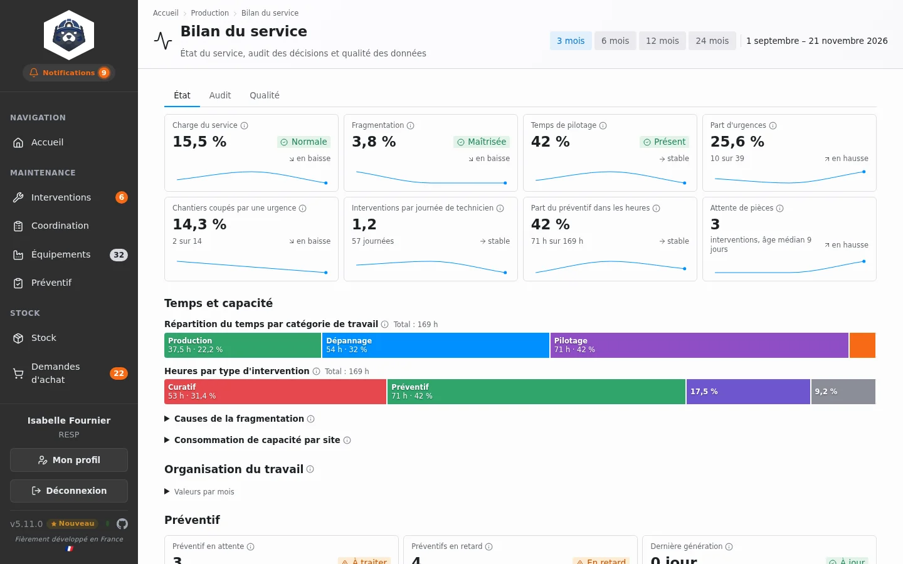
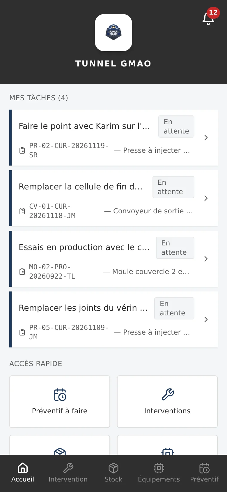
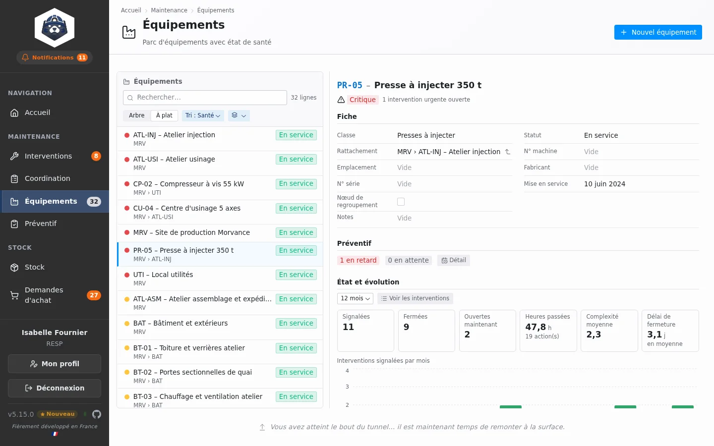
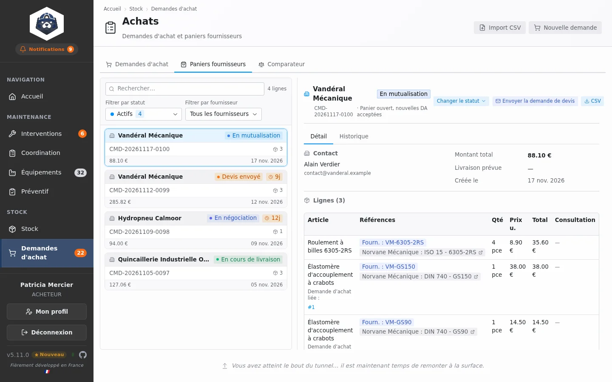

<p align="center">
  
</p>

<h1 align="center">Tunnel GMAO</h1>

<p align="center">
  <strong>Ne vous contentez pas de gérer votre maintenance. Faites-la progresser.</strong>
</p>

<p align="center">
  <a href="https://demo.frezille.fr">Démonstration</a> ·
  <a href="https://tunnel.frezille.fr/docs/">Guide utilisateur</a> ·
  <a href="https://frezille.fr">Site</a> ·
  <a href="deploy/README.md">Installation</a>
</p>

<p align="center">
  
  
  
</p>

GMAO open source pour les PME industrielles de 10 à 100 machines et les équipes de
maintenance de 1 à 10 personnes. Tunnel fait passer une maintenance tenue sur Excel,
Access ou papier à une maintenance structurée, traçable, installée chez vous.

**Essayer** : [demo.frezille.fr](https://demo.frezille.fr), données fictives, un compte
par rôle, réinitialisée chaque nuit.

## Aperçu

<table>
  <tr>
    <td width="68%"></td>
    <td width="32%" rowspan="2"></td>
  </tr>
  <tr>
    <td></td>
  </tr>
  <tr>
    <td colspan="2"></td>
  </tr>
</table>

## Fonctionnalités

**Maintenance**
- Demande → intervention → tâches → actions : l'action est l'unité de travail réel.
- Temps au quart d'heure, nature du travail, complexité de 1 à 10 sur chaque action.
- Clôture, réouverture, rejet ou tâche ignorée : toujours avec un motif choisi.

**Préventif**
- Plans par classe d'équipement, gamme d'étapes devenue tâches.
- Échéancier glissant, interventions créées une semaine avant l'échéance.
- Retards notifiés, lancement en avance, avance ou retard mesuré.

**Équipements et pilotage**
- Arborescence des équipements, fiche avec santé, historique et évolution sur 12 mois.
- Bilan du service : charge, organisation, audit, qualité des données ; aucun chiffre
  individuel par technicien.
- Un accueil par rôle : technicien, acheteur, direction technique.

**Achats**
- Demandes d'achat nées des actions, réparties en paniers par fournisseur.
- Devis, comparateur, commande, réception ; catalogue de pièces et de références.

**Terrain et confiance**
- Interface mobile pour les techniciens (`/m`).
- Journal d'audit non modifiable, droits réglés par rôle, données chez vous.

Le détail, avec la preuve de chaque point et ce qui n'est pas encore livré :
[cahier fonctionnel](docs/cahier-fonctionnel.md).

## Démarrage rapide

```sh
git clone https://github.com/ProtoGulix/tunnel-gmao.git
cd tunnel-gmao/deploy
./install.sh admin@votre-entreprise.fr
docker compose up -d --build
```

Ouvrir <http://127.0.0.1:8080> (web) ou <http://127.0.0.1:8080/m/> (mobile). Le mot de
passe du premier administrateur s'affiche une fois dans `docker compose logs api`.
HTTPS, mise à jour et sauvegarde : [deploy/README.md](deploy/README.md).

## Documentation

- [Guide utilisateur](https://tunnel.frezille.fr/docs/) : par rôle, avec captures.
- [Cahier fonctionnel](docs/cahier-fonctionnel.md) : ce qui est livré, ce qui vient.
- [Décisions d'architecture](docs/decisions/) et [conventions](docs/guides/).

## Technique

- `backend/` : API FastAPI, PostgreSQL, migrations Alembic.
- `web/` et `mobile/` : fronts React et Vite, clients de l'API.
- `deploy/` : Docker Compose, nginx, installation.

## Sécurité

Tunnel sert du HTTP : hors du réseau de l'usine, toujours derrière un proxy HTTPS.
Une faille se signale en privé, voir [SECURITY.md](SECURITY.md).

## Licence

[AGPL-3.0](LICENSE). Les données appartiennent à l'entreprise qui les produit : aucune
collecte, aucune transmission vers l'extérieur. Édité par [Frézille](https://frezille.fr).
